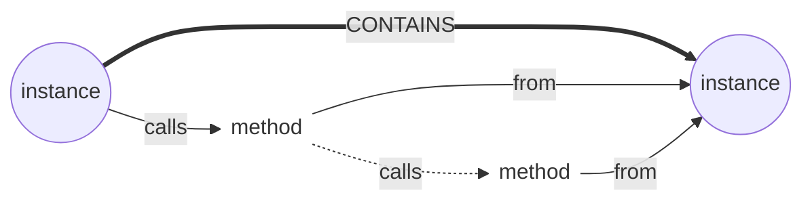
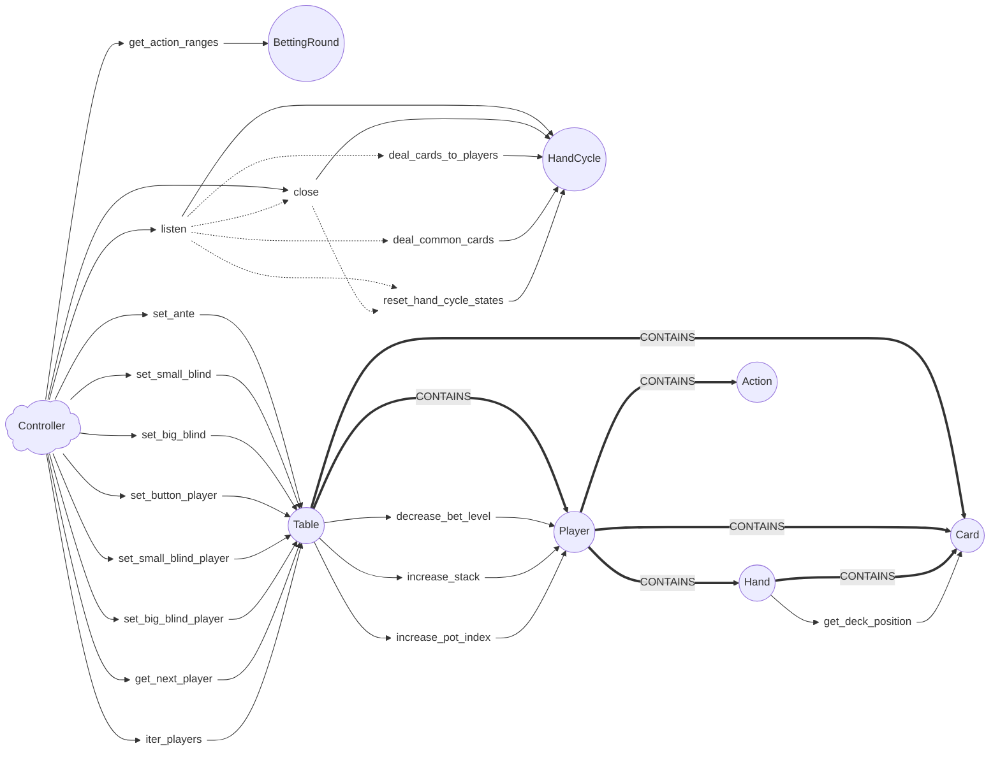
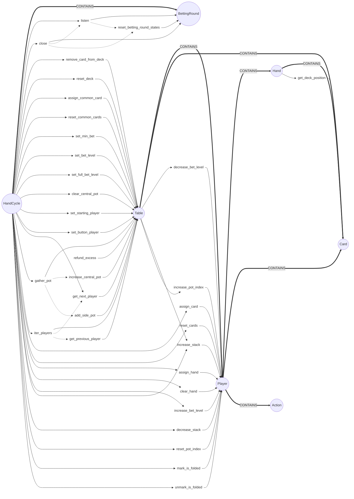
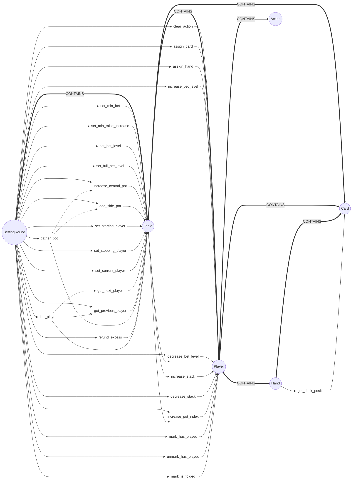

# Properties of structures

### Action (`Action`)

- **Category (`category`):** Name of the action (fold, check, call, bet and raise).

- **Amount (`amount`):** Amount of chips placed in front during the action.

### Card (`Card`)

- **Value (`value`):** Rank of the card (numbers from 2 to 10, jacks, queens, kings and aces).

- **Suit (`suit`):** Symbol paired with the value (clubs, diamonds, hearts and spades).

### Hand (`Hand`)

- **Cards (`cards`):** Set of five cards that make up the hand.

- **Category (`category`):** Rank of the hand (high card, pair, two pair, three of a kind, straight, flush, full house, four of a kind, straight flush and royal flush).

### Player (`Player`)

- **Name (`name`):** Player's identifier, unique within the table.

- **Cards (`cards`):** Cards dealt to the player.

- **Hand (`hand`):** Hand the player holds, according to the game rules.

- **Requested action (`requested_action`):** Action the player has requested in a betting round.

- **Is extra blind (`is_extra_blind`):** Whether the player has requested to place an extra blind.

- **Stack (`stack`):** Chips the player has available to play.

- **Bet level (`bet_level`):** Amount of chips the player has placed in front during the current betting round.

- **Is folded (`is_folded`):** Whether the player has already folded in the current hand cycle.

- **Has played (`has_played`):** Whether the player has already taken a voluntary action during the current betting round (not including forced bets).

- **Pot index (`pot_index`):** Index of the deepest pot the player is playing for, being 0 the main pot.

### Table (`Table`)

- **Deck (`deck`):** Cards still available to be dealt.

- **Common cards (`common_cards`):** Cards dealt as common to all players.

- **Players (`players`):** Players sitting at the table, in their respective order.

- **Live players (`live_players`):** Players still playing for the pot during a hand cycle.

- **Actionable players (`actionable_players`):** Players still playing for the pot and not all-in during a hand cycle.

- **Bettor players (`bettor_players`):** Players who have placed chips in front to gather into the pot.

- **Starting player (`starting_player`):** Player who acts first in the betting round. Defaults to the first player in the players list.

- **Stopping player (`stopping_player`):** Player who acts last in the betting round. This may be updated during the betting round, depending on the actions taken by other players. Defaults to the player before the starting player.

- **Button player (`button_player`):** Player that holds the button.

- **Ante (`ante`):** Ante amount.

- **Small blind (`small_blind`):** Small blind amount.

- **Small blind player (`small_blind_player`):** Small blind player.

- **Big blind (`big_blind`):** Big blind amount.

- **Big blind player (`big_blind_player`):** Big blind player.

- **Current player (`current_player`):** Player who is being awaited to play. Defaults to the starting player.

- **Bet level (`bet_level`):** Largest amount of chips a player has placed in front during the current betting round, which other players must match in order to call.

- **Full bet level (`full_bet_level`):** Part of the bet level matching the last full bet or raise. When a player goes all-in for less than a full bet or raise, it stays the same. Only when a player completes the bet or raise, it is increased.

- **Minimum bet (`min_bet`):** Minimum amount to bet.

- **Minimum raise increase (`min_raise_increase`):** Minimum amount by which to increase the full chip level.

- **Pot (`pot`):** Total amount of chips being played for in the betting round.

- **Split central pot (`split_central_pot`):** "Part of the pot that is already placed at the center of the table, split into main and side pots."

# Properties of engines

### Betting round (`BettingRound`)

- **Name (`name`):** Betting round's identifier, unique within the hand cycle.

- **Table (`table`):** Table in which the betting round takes place.

- **Lap counts (`lap_counts`):** Number of times the action passes through the starting player (even if folded or all-in).

- **Is completed (`is_completed`):** Whether the betting round already ended.

- **Was reseted at closure (`was_reseted_at_closure`):** Whether the betting round states were reseted at closure (helps to track closure behaviour in unit tests).

- **Open fold allowed (`open_fold_allowed`):** Whether folding is allowed when there is no bet or raise to respond to.

- **Raise invalid actions (`raise_invalid_actions`):** Whether an exception should be raised when an invalid action is chosen, or the player should be prompted again.

### Hand cycle (`HandCycle`)

- **Name (`name`):** Hand cycle's identifier, unique within the game.

- **Table (`table`):** Table in which the hand cycle takes place.

- **Betting round (`betting_round`):** Betting round taking place.

- **In extra big blinds phase (`in_extra_big_blinds_phase`):** Whether the hand cycle is in the phase of placing extra big blinds.

- **Is completed (`is_completed`):** Whether the hand cycle already ended.

- **Was reseted at closure (`was_reseted_at_closure`):** Whether the hand cycle states were reseted at closure (helps to track closure behaviour in unit tests).

- **Open fold allowed (`open_fold_allowed`):** Whether folding is allowed when there is no bet or raise to respond to.

- **Raise invalid actions (`raise_invalid_actions`):** Whether an exception should be raised when an invalid action is chosen, or the player should be prompted again.

# Communication model

### Legend

### From controller

### From hand cycle

### From betting round

